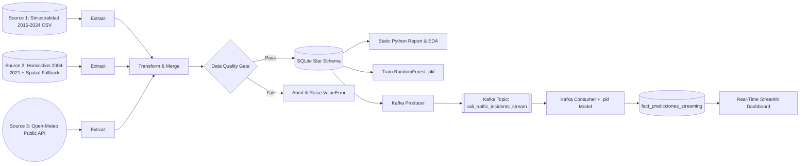

# Technical Documentation — ETL Project: Final Delivery
**Program:** Data Engineering and Artificial Intelligence — Universidad Autónoma de Occidente (UAO)  
**Course:** ETL 
**Project:** End-to-End Cali Mobility Data Warehouse & Real-Time Crash Severity Streaming  
**Laura Torres and Juliana Toro**
---

## 1. Updated System Architecture

architecture_diagram.png

### Block Diagram (Mermaid)


This architecture unifies a scheduled batch dimensional data warehouse and a real-time machine learning inference stream over a single validated data backbone:
1. **Batch Analytical Backbone:** Ingests three complementary sources, standardizes fields, enforces a mandatory Data Quality Gate, loads an idempotent Star Schema in SQLite (`database/cali_mobility_dw.db`), and feeds offline analytical reporting (`reports/generate_static_report.py`) and EDA notebooks.
2. **Operational Real-Time Backbone:** Publishes pre-outcome incident events from the warehouse to Apache Kafka (`cali_traffic_incidents_stream`), scores each event in real time via `kafka/consumer.py` using `accident_severity_pipeline.pkl`, persists risk alerts in `fact_predicciones_streaming`, and updates the live Streamlit dashboard (`dashboard/app.py`).

---

## 2. ETL Pipeline Steps & Apache Airflow DAG Design

### Step-by-Step ETL Flow
1. **Multi-Source Extraction (`src/etl/extract.py`):**
   - **Source 1 — Historical Traffic Crashes (`siniestralidad_2016_2024.csv`):** Primary dataset inherited from previous deliveries (**371,003 records**, 2016–2024, `latin1` encoding, `;` delimiter) read from `data/raw/`, with a seeded reproducible fallback (`cali_accidents_primary.csv`) if raw CSVs are not present in an offline grading environment.
   - **Source 2 — Historical Victim Vulnerability & Spatial Context (`homicidios_en_accidentes_de_transito_segun_condicion_de_victima_en_el_municipio_de_santiago_de_2.csv`):** Annual fatality series (2004–2021, **5,254 total fatalities** across victim conditions) preserved in `dim_victimas_historico`. Because this series is aggregated annually without neighborhood/comuna spatial keys or road density metrics, a reproducible spatial dataset (`cali_road_traffic_secondary.csv`) supplies `zona`, `via_tipo`, and `traffic_density_index` for spatial integration.
   - **Source 3 — Open-Meteo Public Weather API:** Fetches hourly `temperature_2m`, `precipitation`, and `wind_speed_10m` for Cali (`3.4516, -76.5320`, `America/Bogota` timezone) and aggregates hourly profiles (`0–23`), with a deterministic local weather fallback when network access is restricted.
2. **Transformation & Integration (`src/etl/transform.py`):**
   - Deduplicates repeated columns and primary keys (`incident_id`), fixes `latin1` character corruption (`TELEF?NICO` -> `TELEFÓNICO`, `Solo Da?os` -> `Solo daños`, `Ca?da` -> `Caída`), standardizes missing-value tokens (`.`, `SD`, `null`, empty strings) into explicit categories (`No reportado` / `Sin dirección`), parses dates into temporal features (`anio`, `mes`, `dia_semana`, `es_fin_de_semana`), validates vehicle counts (`1–30`), derives the binary target `es_grave`, and merges weather profiles via left joins without multiplying fact rows.
3. **Data Quality Gate (`src/quality/validator.py` & `great_expectations/expectations/cali_traffic_suite.json`):**
   - Evaluates schema completeness, positive row count, `incident_id` non-null/uniqueness, valid temporal bounds (`anio` in `2016–2026`, `mes` in `1–12`), binary target integrity (`{0, 1}`), absence of raw `.` markers in cleaned categorical columns, and valid numeric ranges for `numero_vehiculos`.
4. **Dimensional Warehouse Load (`src/etl/load.py`):**
   - Executes `database/schema.sql` and populates dimension tables (`dim_tiempo`, `dim_ubicacion`, `dim_vehiculo_reporte`, `dim_clima`, `dim_victimas_historico`) before resolving surrogate keys to load `fact_siniestros`.

### Airflow DAG Design (`airflow/dags/cali_mobility_etl_dag.py`)
- **DAG ID & Schedule:** `cali_mobility_etl_ml_pipeline`, scheduled `@daily` (`catchup=False`, `retries=2`, `retry_delay=3 minutes`).
- **Task Dependencies:**
  ```text
  extract_transform_validate >> load_star_schema >> train_severity_model
  ```
- **How Invalid Data Is Blocked:** Inside `extract_transform_validate`, `validate_transformed_data(df_enriched)` executes before any warehouse write or XCom handoff. If any expectation fails, it raises a `ValueError`, marking the Airflow task as `FAILED` and blocking downstream execution of `load_star_schema` and `train_severity_model` so corrupted data cannot enter the warehouse or retrain the production model.

---

## 3. Dual Value Generation Articulation

1. **Operational Value (Real-Time Triage & Dispatch Prioritization):**
   - **Mechanism:** Apache Kafka (`cali_traffic_incidents_stream`) + `kafka/consumer.py` + serialized Random Forest pipeline + `dashboard/app.py` (Streamlit).
   - **Impact:** When an incident report arrives with initial observable context (time, day of week, road/zone context, collision class, involved vehicle type, reporting channel, and weather), the consumer immediately scores its severity probability (`probabilidad_grave`) and assigns an alert tier (`HIGH` >= 0.65, `MEDIUM` 0.40–0.64, `LOW` < 0.40). Traffic control operators use the live Streamlit dashboard to prioritize ambulance and transit agent dispatch toward high-risk events.
2. **Analytical Value (Strategic Road Safety Planning):**
   - **Mechanism:** SQLite Star Schema (`database/cali_mobility_dw.db`) + SQL analytical views (`vw_resumen_anual_gravedad`, `vw_riesgo_por_vehiculo_clima`) + `reports/generate_static_report.py` + EDA notebooks (`01_EDA` and `02_EDA`).
   - **Impact:** Supports multi-year trend evaluation (2016–2024 crash severity rates), identification of high-risk vehicle/collision profiles, weather impact analysis, and historical road-user fatality benchmarking (2004–2021) to guide urban infrastructure interventions and prevention campaigns.

---

## 4. Transformations, Data Quality Rules & Dimensional Model

### Star Schema Design (`database/schema.sql`)
- **Fact Table (`fact_siniestros`):**
  - **Grain:** One row per unique reported traffic incident (`incident_id`), preserving all **371,003 standardized records** from the primary dataset.
  - **Foreign Keys:** `tiempo_key` (`dim_tiempo`), `ubicacion_key` (`dim_ubicacion`), `vehiculo_reporte_key` (`dim_vehiculo_reporte`), and `clima_key` (`dim_clima`).
  - **Measures & Attributes:** `hora_hecho`, `direccion_reporte`, `numero_vehiculos`, `tipo_confirmado_limpio`, and binary target `es_grave`.
- **Dimensions:**
  - `dim_tiempo`: Calendar date breakdown (`anio`, `mes`, `nombre_mes`, `trimestre`, `dia_mes`, `dia_semana`, `nombre_dia`, `es_fin_de_semana`).
  - `dim_ubicacion`: Spatial and road attributes (`comuna`, `barrio`, `zona`, `via_tipo`, `traffic_density_index`).
  - `dim_vehiculo_reporte`: Incident and vehicle classification (`clase_accidente`, `vehiculos_implicados`, `medio_reporte`).
  - `dim_clima`: Hourly weather conditions (`hour_of_day`, `franja_horaria`, `temperature_c`, `precipitation_mm`, `wind_speed_kmh`, `condicion_lluvia`).
  - `dim_victimas_historico`: Aggregated 2004–2021 fatalities by road user condition (`PEATON`, `MOTOCICLISTA`, `CICLISTA`, etc.), stored in a dedicated dimension to avoid mixing annual aggregates with event-level facts.
- **Operational Streaming Table (`fact_predicciones_streaming`):** Stores real-time scored events (`event_id`, `incident_id`, features, `prediccion_es_grave`, `probabilidad_grave`, `nivel_alerta`, `processed_at`).

### Handling Re-Runs & Duplicate Loads (Idempotency)
- `transform.py` deduplicates incoming records on `incident_id` (`keep="first"`).
- `load.py` clears batch tables within a single SQLite transaction before reloading, and `schema.sql` enforces `UNIQUE` constraints on natural keys (`incident_id`, `fecha_hecho`, `(comuna, barrio, via_tipo)`, `(clase_accidente, vehiculos_implicados, medio_reporte)`, `hour_of_day`), ensuring repeated Airflow DAG runs are idempotent.
- `kafka/consumer.py` uses `INSERT OR IGNORE` keyed by `event_id` (UUIDv4) so replayed stream messages never create duplicate prediction rows.

### Meaning of the Metric Published to Kafka
- Each Kafka message represents a **newly reported traffic incident record** containing only **pre-outcome observable attributes** (`anio`, `mes`, `dia_semana`, `es_fin_de_semana`, `hora_hecho`, `numero_vehiculos`, `comuna`, `zona`, `via_tipo`, `traffic_density_index`, `clase_accidente`, `vehiculos_implicados`, `medio_reporte`, `temperature_c`, `precipitation_mm`, `wind_speed_kmh`) plus `event_id` and `event_timestamp`.
- Outcome columns (`es_grave`, `tipo_confirmado_limpio`) are strictly omitted from Kafka payloads to prevent target leakage.

---

## 5. Kafka Streaming Architecture, Message Schema & Inference Flow

- **Kafka Topic:** `cali_traffic_incidents_stream` (`KAFKA_TOPIC_ACCIDENTS` in `src/utils/config.py`).
- **Producer (`kafka/producer.py`):** Queries `fact_siniestros` joined with dimension tables, excludes outcome columns, attaches a unique `event_id` (UUIDv4) and UTC `event_timestamp`, serializes each event to UTF-8 JSON, and publishes records with a configurable delay (`delay_seconds=0.5`).
- **JSON Message Structure:**
  ```json
  {
    "event_id": "8f14e45f-ea9a-4c1b-9b2d-1a2b3c4d5e6f",
    "event_timestamp": "2026-11-21T21:15:00.123456+00:00",
    "incident_id": "AI010195",
    "anio": 2024,
    "mes": 11,
    "dia_semana": 4,
    "es_fin_de_semana": 0,
    "hora_hecho": 12,
    "numero_vehiculos": 2.0,
    "comuna": "Sin comuna en fuente",
    "zona": "Urbana General",
    "via_tipo": "Avenida Principal",
    "traffic_density_index": 0.65,
    "clase_accidente": "Choque",
    "vehiculos_implicados": "MOTOCICLETA",
    "medio_reporte": "TELEFÓNICO 127",
    "temperature_c": 26.4,
    "precipitation_mm": 0.2,
    "wind_speed_kmh": 9.1
  }
  ```
- **Consumer & Per-Message Inference (`kafka/consumer.py` & `dashboard/app.py`):**
  1. Loads `ml/models/accident_severity_pipeline.pkl` once at startup.
  2. Deserializes each incoming JSON message into a single-row `DataFrame` aligned with `NUMERIC_FEATURES + CATEGORICAL_FEATURES`.
  3. Runs `model.predict()` and `model.predict_proba()[:, 1]` to compute `predicted_is_severe` (`0` or `1`) and `severe_probability`.
  4. Maps `severe_probability` to `alert_level` (`HIGH`, `MEDIUM`, `LOW`), persists the scored record in `fact_predicciones_streaming`, and updates the live Streamlit dashboard KPIs, feed table, and probability trend chart.

---

## 6. Static Analytical Report & Key Findings

- **Generator Script:** `reports/generate_static_report.py` (outputs `reports/static_output/mobility_analytical_report.md`, `annual_severity_rate.png`, and `top_risk_combinations.png`).
- **Analytical Questions Answered:**
  1. *How have total traffic incidents and severe crash rates evolved in Cali between 2016 and 2024?*
  2. *Which combinations of vehicle type, collision class, and weather condition exhibit the highest severity rates?*
  3. *Which road user groups bear the highest historical fatality burden (2004–2021)?*
- **Main Insights:**
  - Across **371,003** historical records (2016–2024), **50,860 incidents (13.71%)** resulted in confirmed injuries or fatalities (`es_grave = 1`), while **320,143 (86.29%)** were non-severe (`Negativo`, `Solo daños`, or minor/unconfirmed calls).
  - Historical fatality records (2004–2021, **5,254 deaths**) show that vulnerable road users account for **88.43%** of all traffic fatalities: **Pedestrians (2,168 / 41.26%)**, **Motorcyclists (1,766 / 33.61%)**, and **Cyclists (712 / 13.55%)**.
  - Collisions involving motorcycles and pedestrian impacts (`Atropello`) consistently exhibit higher severe-outcome proportions than property-damage vehicle collisions.
- **How to Regenerate:**
  ```bash
  python -m reports.generate_static_report
  ```

---

## 7. Machine Learning Workflow & Limitations

- **Prediction Problem:** Binary classification predicting `es_grave` (`1` = confirmed injury/fatality, `0` = non-severe) at report intake time to prioritize emergency dispatch and traffic enforcement.
- **Features (`X`):**
  - *Numeric (10):* `anio`, `mes`, `dia_semana`, `es_fin_de_semana`, `hora_hecho`, `numero_vehiculos`, `traffic_density_index`, `temperature_c`, `precipitation_mm`, `wind_speed_kmh`.
  - *Categorical (6):* `clase_accidente`, `vehiculos_implicados`, `medio_reporte`, `comuna`, `zona`, `via_tipo`.
- **Leakage Prevention & Preprocessing:** `tipo_confirmado`, `tipo_confirmado_limpio`, and victim counts are strictly excluded from model inputs and Kafka event payloads. Preprocessing (`SimpleImputer`, `StandardScaler`, `OneHotEncoder(handle_unknown="ignore")`) is encapsulated inside a single `sklearn.pipeline.Pipeline` fit only on the 80% stratified training split and serialized via `joblib` (`ml/models/accident_severity_pipeline.pkl`).
- **Model & Evaluation Metrics:** `RandomForestClassifier(n_estimators=120, max_depth=14, min_samples_leaf=10, class_weight="balanced", random_state=42)` evaluated on a stratified 20% holdout split (`accuracy`, `precision`, `recall`, `f1_score`, and `roc_auc` saved to `ml/models/metrics.json`).
- **Limitations:**
  - `siniestralidad_2016_2024.csv` does not record exact crash timestamps (`hora_hecho` defaults to `12` when absent in the raw CSV) or structured `comuna`/`barrio` codes (free-text `Dirección reporte` is provided instead), which limits intra-day and neighborhood-level discrimination on historical records.
  - High missingness (`.`) in raw `clase_accidente` and `medio_reporte` reduces feature granularity for older records.

---

## 8. General Assumptions, Limitations & Execution Instructions

### Assumptions & Limitations
- **Raw Data Availability:** Large CSV files (`siniestralidad_2016_2024.csv`) are excluded from Git via `.gitignore` and stored in `data/raw/` locally; when absent, deterministic fallback generators preserve end-to-end reproducibility.
- **Weather Alignment:** Open-Meteo provides current/recent hourly profiles aggregated by hour of day (`0–23`), serving as an hourly climatological proxy when joined to multi-year historical dates.
- **Warehouse Engine:** SQLite (`database/cali_mobility_dw.db`) is used for lightweight portability; for concurrent multi-writer production workloads, migrating the same DDL to PostgreSQL is recommended.

### Installation & Execution Instructions
1. **Environment Setup:**
   ```bash
   python -m venv .venv
   # Windows PowerShell:
   .venv\Scripts\Activate.ps1
   pip install -r requirements.txt
   ```
2. **Place Raw Sources (Optional for Real Data Run):**
   Copy `siniestralidad_2016_2024.csv` and `homicidios_en_accidentes_de_transito_segun_condicion_de_victima_en_el_municipio_de_santiago_de_2.csv` into `data/raw/`.
3. **Run Batch ETL, Data Quality Gate, Star Schema Load & Model Training:**
   ```bash
   python -m src.etl.run_pipeline
   ```
4. **Generate Static Analytical Report & Charts:**
   ```bash
   python -m reports.generate_static_report
   ```
5. **Run Automated Tests:**
   ```bash
   pytest tests/test_pipeline.py
   ```
6. **Start Kafka & Real-Time Streaming Demo:**
   ```bash
   # Terminal 1: Start Kafka & Airflow services
   docker-compose up -d

   # Terminal 2: Launch live Streamlit dashboard (Kafka Consumer)
   streamlit run dashboard/app.py

   # Terminal 3: Stream incident events into Kafka
   python -m kafka.producer
   ```