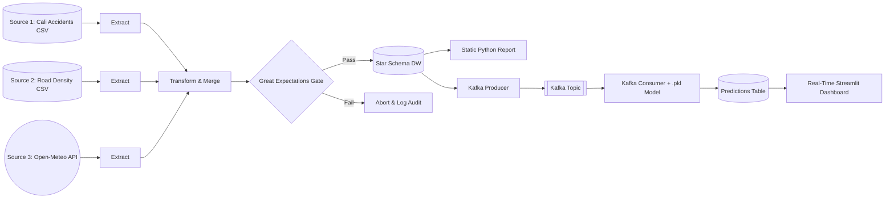

# Technical Documentation — ETL Project: Final Delivery
**Program:** Data Engineering and Artificial Intelligence — Universidad Autónoma de Occidente (UAO)  
**Course:** ETL (G51)

---

## 1. Architecture Overview & Dual Value Generation
This architecture unifies batch analytical warehousing and real-time operational ML inference over a single validated data backbone:

1. **Analytical Process (Strategic Decision-Making):**
   - Extracts data from three complementary sources: (1) Cali Traffic Accidents historical dataset, (2) Cali Road Infrastructure & Traffic Density dataset, and (3) Open-Meteo Public Weather API.
   - Orchestrates cleaning, spatial/temporal integration, and Great Expectations validation inside Apache Airflow before loading an idempotent Star Schema (`fact_traffic_incident` + 4 dimensions).
   - Powers a point-in-time Python Static Analytical Report (`reports/generate_static_report.py`) answering urban road safety questions.
2. **Operational Process (Real-Time Risk Scoring):**
   - A Kafka Producer streams enriched incident features (excluding target fields to prevent leakage) to `cali_traffic_incidents_stream`.
   - A standalone Kafka Consumer loads the serialized `scikit-learn` pipeline (`accident_severity_pipeline.pkl`), predicts severe injury probability in real time, persists results to `streaming_incident_predictions`, and updates a live Streamlit dashboard.

### Block Diagram (Mermaid)

---

## 2. Data Sources & Integration Logic
- **Source 1 (`cali_accidents_primary.csv`):** Core incident records (`incident_id`, date, hour, `comuna`, `barrio`, `clase_vehiculo`, `servicio`, `victimas`).
- **Source 2 (`cali_road_traffic_secondary.csv`):** Enriches spatial context (`zona`, `via_tipo`, `traffic_density_index`) joined on `(comuna, barrio)`.
- **Source 3 (`Open-Meteo Public API`):** Enriches environmental conditions (`temperature_c`, `precipitation_mm`, `wind_speed_kmh`) joined on `hour_of_day`. Includes a deterministic local fallback profile if external network access is restricted during evaluation.

---

## 3. Data Quality & Dimensional Model
- **Validation Gate (`src/quality/validator.py`):** Evaluates 7 expectations (row count bounds, unique `incident_id`, non-null foreign keys, valid hour `0–23`, realistic Cali temperature `5–45°C`, traffic density `0–1`, binary target `{0,1}`). Every run logs metrics to `dq_validation_logs`. Any critical failure raises `DataQualityException`, preventing corrupted data from reaching the Star Schema.
- **Dimensional Model (`database/schema.sql`):**
  - **Fact Table (`fact_traffic_incident`):** Grain = 1 traffic incident event. Measures = `victims_count`, `is_severe_injury`, `temperature_c`, `precipitation_mm`, `wind_speed_kmh`, `traffic_density_index`.
  - **Dimensions:** `dim_date`, `dim_location`, `dim_vehicle`, `dim_weather`.
  - **Idempotency:** Dimensions use `INSERT OR IGNORE` on natural unique constraints; `fact_traffic_incident` uses `INSERT OR REPLACE` on primary key `incident_id`, making repeated Airflow DAG runs completely idempotent.

---

## 4. Machine Learning Workflow & Limitations
- **Prediction Problem:** Binary classification predicting `is_severe_injury` (`1` = Severe/Fatal risk, `0` = Minor/Property damage) to prioritize emergency dispatch and traffic enforcement.
- **Features:** `comuna`, `zona`, `via_tipo`, `clase_vehiculo`, `servicio`, `hour_of_day`, `is_weekend`, `temperature_c`, `precipitation_mm`, `wind_speed_kmh`, `traffic_density_index`.
- **Leakage Prevention:** `victims_count` and `is_severe_injury` are strictly excluded from Kafka event payloads and model inputs. Preprocessing (`SimpleImputer`, `OneHotEncoder`, `StandardScaler`) is encapsulated inside a single `sklearn.pipeline.Pipeline` fit only on the 80% training split and serialized via `joblib`.
- **Limitations:** Weather joins use hourly profiles rather than micro-station radar per street intersection; synthetic baseline fallback records are included when offline.
